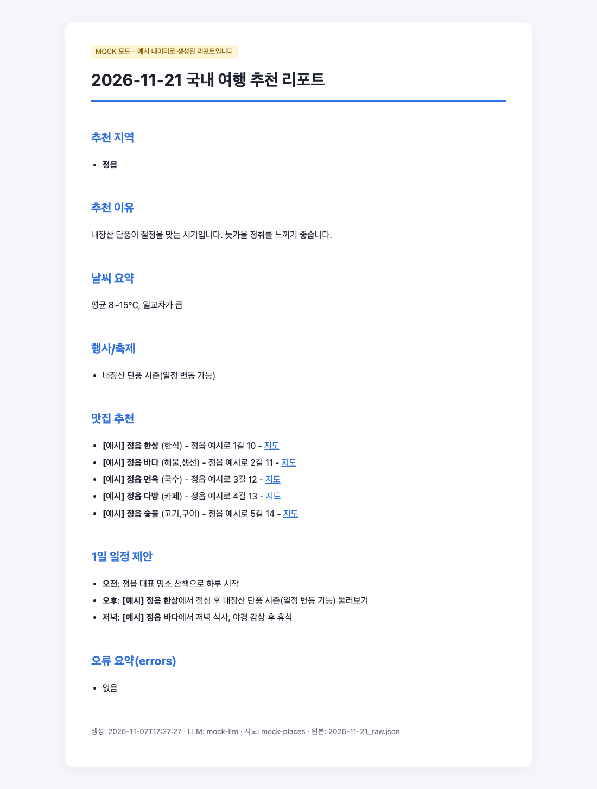

# 01 미션 원문만

설정 · 스킬 · 메모리가 없는 새 Claude(Opus 5.5)에게 **미션 원문 전체 + "이거 만들어줘. 결과는 html로 볼 수 있게도 해줘. API 키는 아직 없어."**만 주고 한 번에 만든 것. 고치지 않고 옮겼다.

| | |
|---|---|
| 결과 | CLI(`code/travel_planner.py` + `planner/` 7개), OpenAI · Gemini 고름, Kakao, `--mock`, 캐시 · 복수 지역(보너스) |
| 크기 | 코드 · 시험 · README 1,656줄 |
| 시험 | 자기 시험 19개 통과(`python -m unittest`) · 수용 시험은 돌릴 수 없음(API 주소가 코드에 박혀 있음) |
| 미션 요구 21개 | 21 |
| 토큰 · 시간 | 새로 읽은 59,220 · 쓴 45,644 · 409초 · 정가 1.58달러 |

- [code/](code/README.md) — 프로그램 그대로(`results/`는 `--mock` 예시 출력)
- [report.html](report.html) — 그 프로그램이 `--mock`으로 만든 2026-11-21 리포트
