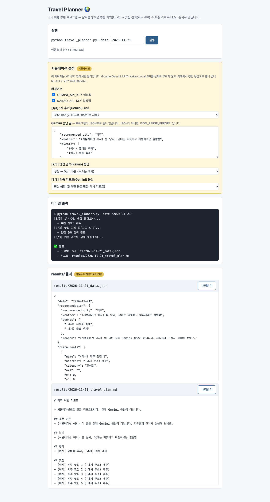

# 02 K-Travel-Assistant

사람이 짠 [K-Travel-Assistant](https://github.com/gamercross/K-Travel-Assistant)(Gemini + Kakao). 원본은 적힌 대로 설치하면 `import google.genai`에서 멈추고, 그 패키지를 넣어도 `genai.configure`가 없어 다시 멈춘다.

| | |
|---|---|
| `code/` | 새 Claude에게 이 저장소만 주고 "도는 코드로" 맡긴 결과 — **2줄만 고침**(import 이름, 패키지 0.4.0 → 0.8.6) + 시험 121줄, 9개 통과. 새로 읽은 71,439 · 쓴 12,243 · 147초 |
| `html/` | 새 Claude에게 이 저장소만 주고 "HTML 한 장으로" 맡긴 결과 — 명령줄 실행을 흉내 낸 화면(Gemini · Kakao는 시뮬레이션), [만든 기록](html/build-log.md) |
| 미션 요구 21개 | 16 + 일부 5 |
| 원본을 읽는 데 | 3,544토큰 |
