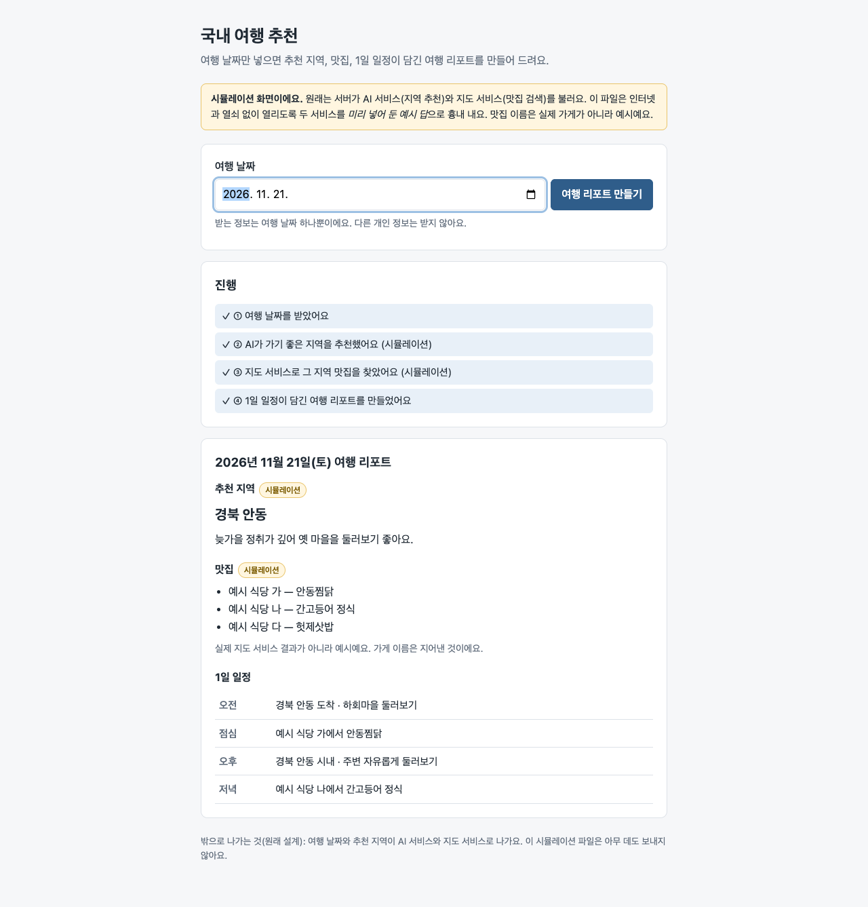

# 03 test-1 첫 실행(Floe)

Floe 여덟 단계를 처음 지나며 남은 [test-1 문서 27개](https://github.com/gamercross/test-1/tree/floe-run-1) — 코드는 없다. 받은 글(미션)이 앞 399자에서 잘려 4단계가 "서버가 있는 웹"을 골랐고, 숫자는 "아직 모름" 63번.

| | |
|---|---|
| `code/` | 새 Claude에게 그 문서만 주고 "도는 코드로" 맡긴 결과 — Flask 웹 343줄, 시험 11개 통과. 어떤 AI · 지도를 쓸지 문서에 없어 OpenAI · Kakao · Flask를 스스로 골랐다. 새로 읽은 128,919 · 쓴 18,870 · 197초 |
| `html/` | 그 문서만 주고 "HTML 한 장으로" 맡긴 결과 — 날짜 → 리포트(AI · 지도는 시뮬레이션), [만든 기록](html/build-log.md) |
| 미션 요구 21개 | 문서 2 + 일부 1 · 코드 4 + 일부 5 |
| 원본을 읽는 데 | 55,053토큰(반복 43%) |
