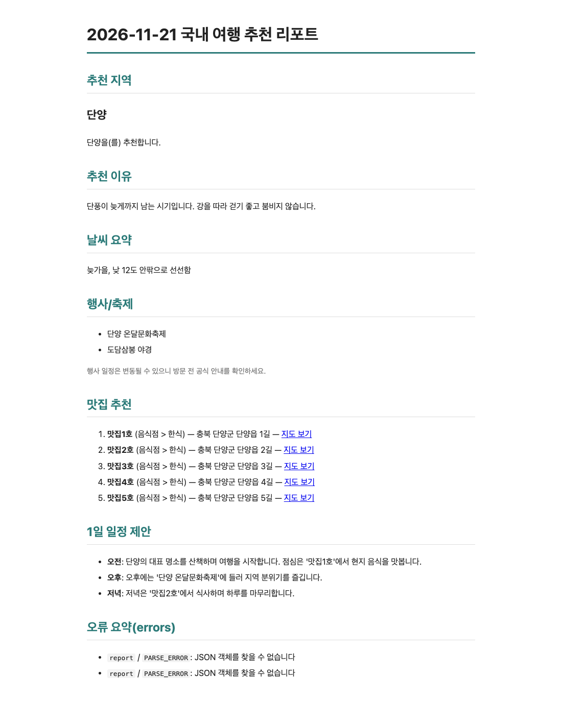

# 04 기준 · Claude만

설정 · 스킬 · 메모리가 없는 새 Claude(Opus 5.5)에게 **미션 원문 + [기준 v1](../standard/STANDARD.md) + "이거 만들어줘. API 키는 아직 없어."**만 주고 한 번에 만든 것. 고치지 않고 옮겼다.

| | |
|---|---|
| 수용 시험 | **24 / 24** (`bash standard/run.sh 04-standard-claude/code`) |
| 미션 요구 21개 | 21 · 보너스 캐시(`--use-cache`) |
| 결과 | `code/travel_planner.py` 한 파일 759줄, README 136줄, 자기 시험 파일은 없음(가짜 서버를 띄워 손수 확인했다고 보고) |
| 토큰 · 시간 | 새로 읽은 71,231 · 쓴 29,417(생각 5,710) · 19응답 · 267초 · 정가 1.31달러 |

- [sample-run/](sample-run/2026-11-21_travel_plan.md) — `standard/demo.py`로 가짜 데이터를 넣어 돌린 결과. 리포트 문장을 LLM에게 JSON으로 받는 구현이라 가짜 서버(Markdown으로 답함)에서는 errors에 `report` 두 줄이 남고 가진 데이터로 리포트를 만든다.
