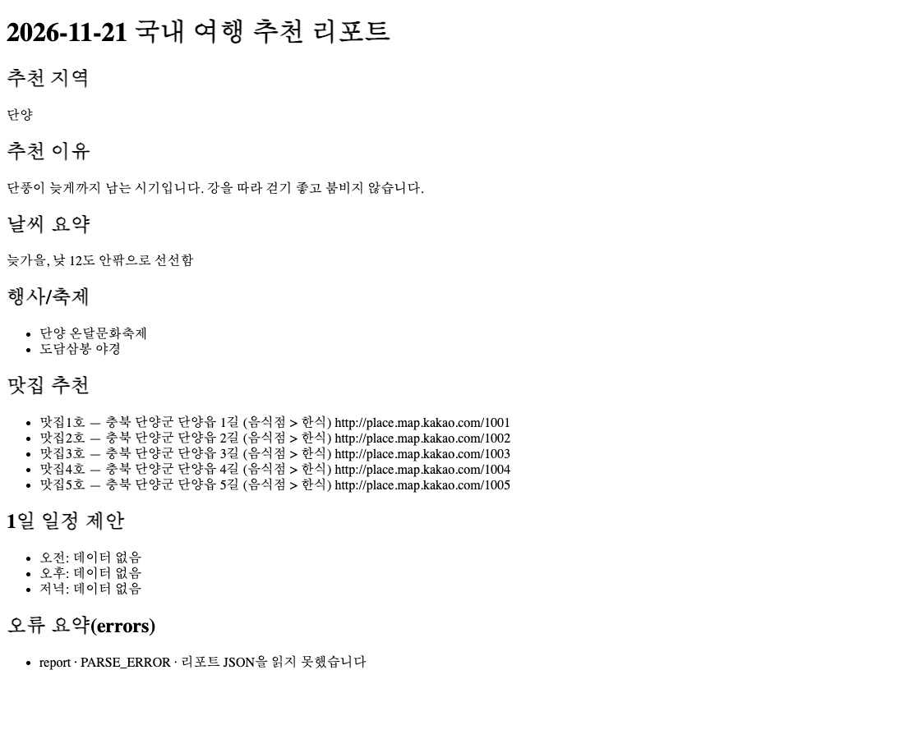

# 05 기준 · Floe

04와 **같은 글(미션 원문 + 기준 v1)**을 Floe에 넣고, Floe 화면이 하는 순서대로 진행했다 — 사람 몫(칸마다 맞아요 · 고르기 · 관문)은 Claude가 Floe 서버 API와 Floe 모듈로 대신 했다.

1. `/api/start` — 받은 글 전부로 1단계 초안 · `/api/stagedraft` — 2 ~ 6단계 초안(앞 400자 + 지난 단계 결과)
2. Floe `docs.js`로 단계 문서를 쓰고
3. Floe `build.js`의 맡김 글 그대로 Claude Code에 4번 — 5단계 뼈대 1번 + 6단계 기능 줄 3번(매번 새 세션)
4. 7 · 8단계 초안 → 단계 문서 다시

| | |
|---|---|
| 수용 시험 | **24 / 24** (`bash standard/run.sh 05-standard-floe/code`) |
| 미션 요구 21개 | 21 · 보너스 없음 |
| 결과 | `code/travel_planner.py` 283줄, 자기 시험 4파일 504줄(27개 통과), README 106줄, **Floe 단계 문서 22개**(`code/docs/`) |
| Floe 초안 | 8번 · 84,432토큰 · 83초(Sonnet · 생각 낮음 — Floe 기본값) |
| 맡김 4번 | 새로 읽은 180,897 · 쓴 44,561 · 465초 · 정가 2.71달러 |

**문서와 코드가 엇갈렸다.** 단계 문서는 4단계 "서버가 있는 웹", 3단계 숫자 "아직 모름"(2 ~ 8단계 초안이 받은 글의 앞 400자만 본다). Claude Code는 Floe가 보관한 원문(`docs/00-source/idea.md`)을 읽고 CLI로 만들었고, 그 충돌을 README '정할 것'에 남겼다. 이 공개 저장소에는 원문 파일을 싣지 않았다(자리에 안내만).

- [code/docs/PRD.md](code/docs/PRD.md) — Floe 기획서 · [결정 기록](code/docs/decisions.md)
- [sample-run/](sample-run/2026-11-21_travel_plan.md) — 가짜 데이터로 돌린 결과(04와 같은 까닭으로 errors에 `report` 한 줄, 일정은 "데이터 없음")
