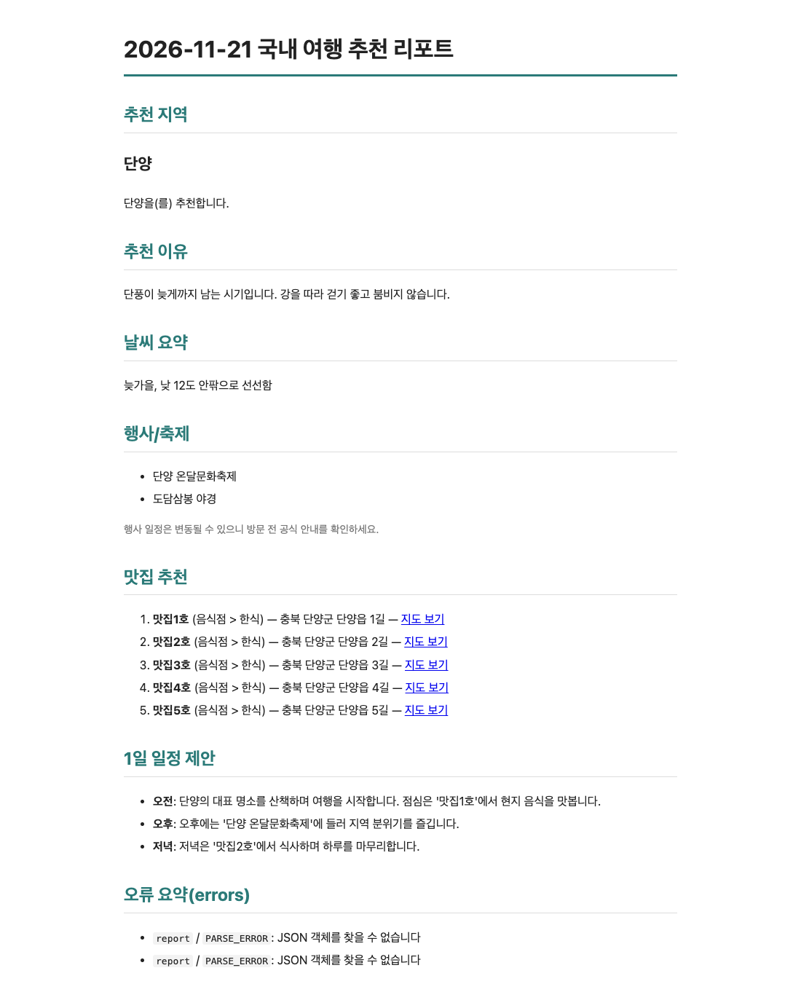
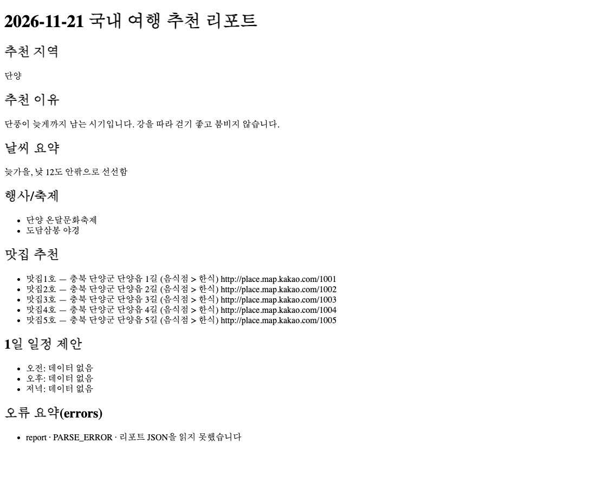
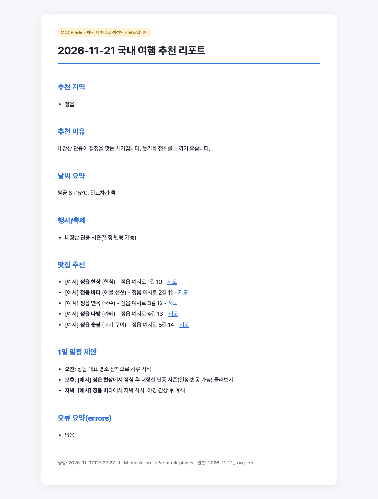
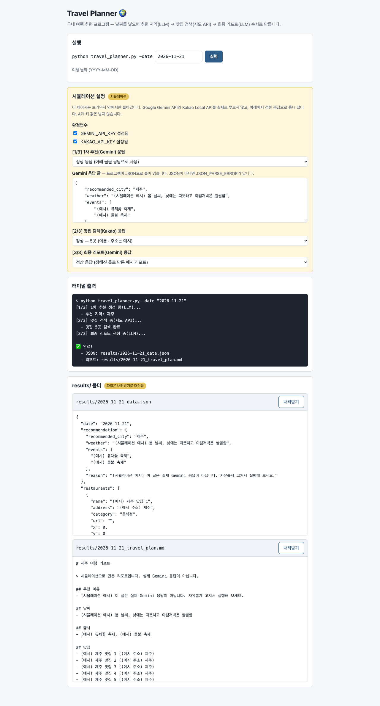
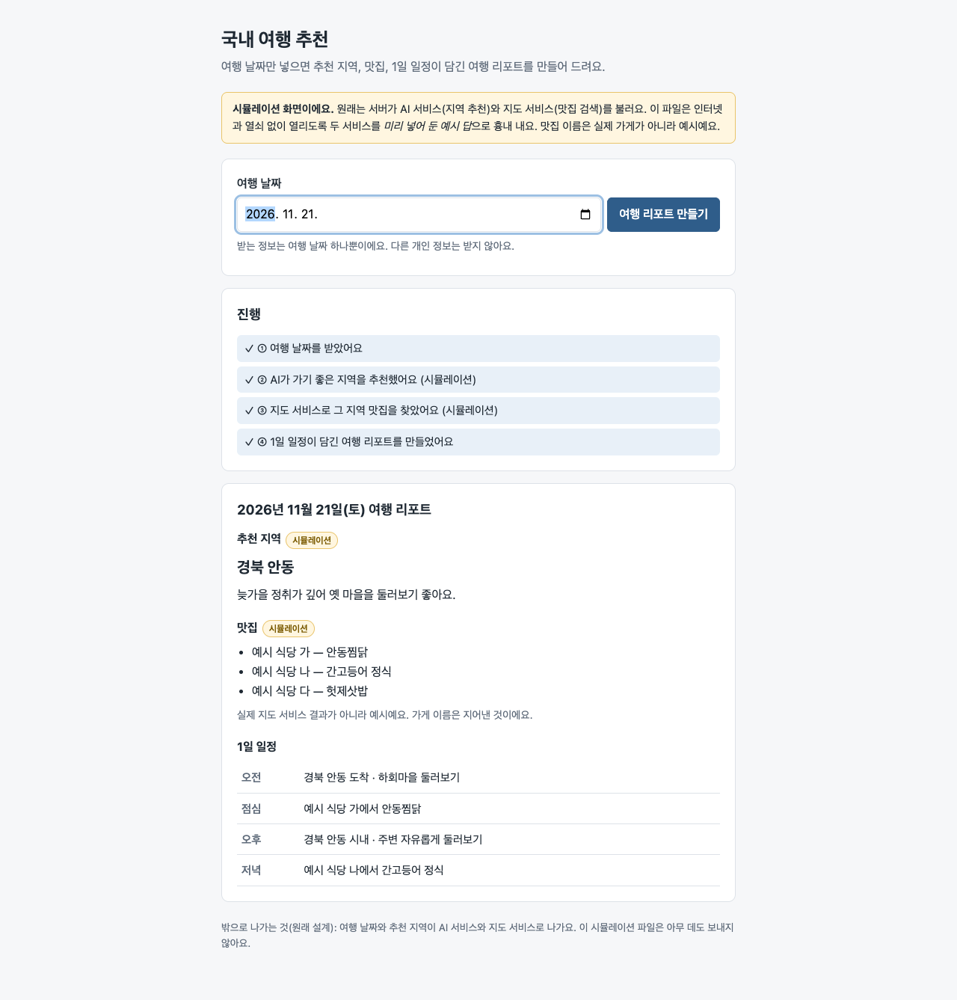

# Final-Proj-Result — 같은 미션, 다섯 가지 출발점

코디세이 AI 활용 **미션 1 "국내 여행 추천 프로그램"**(여행 날짜 → LLM이 지역 추천 → 지도 API로 맛집 → 여행 리포트)을 다섯 가지 출발점에서 Claude(Opus 5.5)에게 만들게 하고, 나란히 견줬다. 2026-11-07.

- **01 ~ 03**은 기준 없이 만든 첫 실험이다 — 미션 원문만 / 사람이 짠 코드 / Floe의 첫 실행 문서.
- 결과 화면이 제각각이라 **미션을 토대로 기준 하나와 수용 시험 24개를 먼저 만들고**([standard/](standard/README.md)), 그 기준으로 **04 Claude만 · 05 Floe를 거쳐** 다시 만들었다.

## 한눈에

| | 01 미션 원문만 | 02 K-Travel | 03 test-1 첫 실행 | **04 기준 · Claude만** | **05 기준 · Floe** |
|---|---|---|---|---|---|
| 준 것 | 미션 원문 | 사람이 짠 코드(돌지 않음) | Floe 단계 문서 27개(코드 없음) | 미션 원문 + 기준 | 미션 원문 + 기준을 Floe에 → Floe가 Claude Code에 4번 맡김 |
| 만든 모양 | CLI | CLI(2줄 고침) | Flask 웹 | CLI | CLI |
| **수용 시험 24개** | 돌릴 수 없음¹ | 돌릴 수 없음¹ | 돌릴 수 없음¹ | **24 / 24** | **24 / 24** |
| **미션 요구 21개** | 21 | 16 + 일부 5 | 4 + 일부 5 | **21** | **21** |
| 자기 시험 | 19 통과 | 9 통과 | 11 통과 | 없음(가짜 서버로 손수 확인) | 27 통과 |
| 보너스(캐시 · 복수 지역) | ✓ · ✓ | ✗ · ✗ | ✗ · ✗ | ✓ · ✗ | ✗ · ✗ |

¹ 01 ~ 03은 기준을 만들기 전에 만든 것이다. API 주소를 바꿀 수 없거나(01), LLM이 Gemini이거나(02), 웹 서버라(03) 같은 시험으로 돌릴 수 없다 — 미션 요구 21개 표로 봤다.

## 성능 — 토큰 · 시간 · 비용

| | 01 미션 원문만 | 02 K-Travel | 03 test-1 첫 실행 | 04 기준 · Claude만 | 05 기준 · Floe |
|---|---:|---:|---:|---:|---:|
| 원본을 읽는 데 드는 토큰 | 4,484 | 3,544 | 55,053 | 약 6,000² | 같음 + Floe 문서 |
| 만들 때 **새로 읽은** 토큰 | 59,220 | 71,439 | 128,919 | 71,231 | 180,897 |
| 만들 때 **쓴** 토큰(코드 · 글 · 생각) | 45,644 | 12,243 | 18,870 | 29,417 | 44,561 |
| Floe 초안(Sonnet · 생각 낮음, 8번) | — | — | — | — | 84,432 |
| 걸린 시간 | 409초 | 147초 | 197초 | **267초** | 465초 + 초안 83초 |
| 정가 환산(Opus 5.5) | 1.58달러 | — | — | **1.31달러** | 2.71달러 + 초안 |
| 응답 수 | 24 | 14 | 18 | 19 | 9 · 13 · 9 · 14(네 세션) |

- "새로 읽은" = 캐시에 새로 쓴 입력, "쓴" = 출력(생각 포함). 같은 내용을 다시 읽은 몫은 세지 않았다.
- 02 · 03은 "이 저장소로 도는 코드를 만들라"고 맡긴 실행의 기록이다(정가는 따로 남지 않음).
- ² 미션 원문 4,484토큰에 기준 1,792자를 더한 어림.

**04와 05는 같은 것을 받아 같은 시험을 모두 통과했다.** 05는 Floe의 8단계 초안과 네 번의 맡기기를 거쳐 토큰을 약 2.5배(새로 읽은 것), 시간을 약 2배 더 썼고, 그 대신 **단계 문서 22개와 자기 시험 27개**가 남았다.

사람이 원한 것이 명령줄 프로그램이 아니라 **웹 앱**일 때 토큰이 얼마나 들지는 재지 않았다 — 잰 조각으로 낸 추정(사람 + Floe 약 52만)과 가정으로 낸 예측(Floe 없이 약 100만)은 [estimate/](estimate/README.md)에 따로 적었다.

## 화면

같은 가짜 데이터(단양 · 맛집 5곳)로 돌렸다. 04 · 05는 리포트 문장을 LLM에게 JSON으로 받는데 가짜 서버가 Markdown으로 답해, 둘 다 "가진 데이터로 만들기" 쪽으로 간 화면이다 — 그때 04는 데이터로 일정을 채우고, 05는 일정을 "데이터 없음"으로 둔다.

| 04 기준 · Claude만 | 05 기준 · Floe |
|---|---|
|  |  |

기준 이전(01 ~ 03)의 화면 — 01은 그 프로그램이 만든 HTML 리포트, 02 · 03은 그 저장소를 읽고 만든 HTML(AI · 지도는 시뮬레이션).

| 01 미션 원문만 | 02 K-Travel | 03 test-1 첫 실행 |
|---|---|---|
|  |  |  |

## 미션 요구 21개 — 누가 채웠나

✓ 됨 · △ 일부 · ✗ 없음. 04 · 05는 수용 시험으로, 01 · 03은 돌려 보고, 02는 코드를 읽어 판정했다.

| # | 미션 요구 | 01 | 02 | 03 | 04 | 05 |
|---:|---|:-:|:-:|:-:|:-:|:-:|
| 1 | argparse로 CLI | ✓ | ✓ | ✗ 웹 | ✓ | ✓ |
| 2 | `-date` 필수 | ✓ | ✓ | ✗ | ✓ | ✓ |
| 3 | 날짜가 틀리면 사용법 후 종료 | ✓ | △ | △ | ✓ | ✓ |
| 4 | LLM은 OpenAI 또는 Gemini | ✓ | ✓ | ✓ | ✓ | ✓ |
| 5 | 지도는 Kakao 또는 Naver | ✓ | ✓ | ✓ | ✓ | ✓ |
| 6 | 1차 JSON 4키 | ✓ | ✓ | ✗ | ✓ | ✓ |
| 7 | 추천 도시로 맛집 검색 | ✓ | ✓ | ✓ | ✓ | ✓ |
| 8 | 맛집 5곳 + 필드 | ✓ | ✓ | △ | ✓ | ✓ |
| 9 | 0건이어도 "데이터 없음"으로 계속 | ✓ | ✓ | △ | ✓ | ✓ |
| 10 | 리포트 항목(지역 · 이유 · 날씨 · 행사 · 맛집 · 일정) | ✓ | △ | ✗ | ✓ | ✓ |
| 11 | try-except | ✓ | △ | △ | ✓ | ✓ |
| 12 | 키 없으면 즉시 종료 + 안내 | ✓ | ✓ | △ | ✓ | ✓ |
| 13 | 지도 실패에도 계속 | ✓ | ✓ | ✗ | ✓ | ✓ |
| 14 | JSON 파싱 실패 → 재시도 1회 | ✓ | ✓ | ✗ | ✓ | ✓ |
| 15 | errors 목록 + 리포트 요약 | ✓ | △ | ✗ | ✓ | ✓ |
| 16 | 키는 환경변수 · `.env` | ✓ | ✓ | ✓ | ✓ | ✓ |
| 17 | `results/` 날짜 기준 저장 | ✓ | ✓ | ✗ | ✓ | ✓ |
| 18 | JSON = 추천 + 맛집 + errors | ✓ | ✓ | ✗ | ✓ | ✓ |
| 19 | 리포트 `.md` | ✓ | ✓ | ✗ | ✓ | ✓ |
| 20 | README 다섯 가지 | ✓ | △ | ✗ | ✓ | ✓ |
| 21 | Python 3.10+ 터미널 | ✓ | ✓ | ✗ | ✓ | ✓ |

## 05에서 본 것 — Floe의 문서와 코드가 엇갈렸다

Floe는 받은 글 전부(미션 + 기준, 7,038자)로 1단계 초안을 만들지만, **2 ~ 8단계 초안은 앞 400자만** 본다. 그래서 05의 단계 문서는 첫 실행(03)과 똑같이 갔다.

- 4단계 "고른 방법" — **"서버가 있는 웹"**(미션 · 기준은 CLI · 웹 UI 필요 없음)
- 3단계 "숫자로" — 맛집 몇 곳 · 성공 기준 모두 **"아직 모름"**(기준은 5곳)
- 어디에도 OpenAI · Kakao라는 이름이 없다

그런데 코드는 기준대로 CLI · OpenAI · Kakao로 나왔다. Floe가 이번에는 받은 글 전부를 `docs/00-source/idea.md`로 보관했고, Floe가 Claude Code에 보낸 맡김 글이 "docs/를 먼저 읽으라"고 해서 Claude Code가 원문을 읽었다. 첫 맡김의 보고: **"4단계 결정은 '서버가 있는 웹'인데 원문(`docs/00-source/idea.md` 209 ~ 222줄)은 명령줄 프로그램을 정하고 웹 화면은 필요 없다고 한다 — 원문을 따랐고, 기록된 결정을 바꾸려면 답이 필요해 README '정할 것'에 남겼다."** 결과는 맞았지만 단계 문서와 코드가 서로 다른 말을 한 채로 남았다. 원문 보관이 없던 03의 문서만 읽고 만든 코드는 웹이었다.

## 폴더

| 폴더 | 안에 든 것 |
|---|---|
| [standard/](standard/README.md) | 기준 v1([STANDARD.md](standard/STANDARD.md)), 수용 시험 24개(가짜 OpenAI · Kakao 서버), 시험 확인용 기준 구현(24/24), `run.sh` · `demo.py` |
| [01-mission-only/](01-mission-only/README.md) | 미션 원문만 받은 Claude의 프로그램(`code/`), 그 프로그램의 HTML 리포트 |
| [02-k-travel/](02-k-travel/README.md) | K-Travel-Assistant를 도는 코드로(`code/`), 그 저장소를 읽고 만든 HTML(`html/`) |
| [03-test-1-run-1/](03-test-1-run-1/README.md) | test-1 첫 실행 문서로 만든 코드(`code/`) · HTML(`html/`) — 문서는 [test-1 floe-run-1](https://github.com/gamercross/test-1/tree/floe-run-1) |
| [04-standard-claude/](04-standard-claude/README.md) | 미션 + 기준만 받은 Claude의 프로그램(`code/`), 가짜 데이터로 돌린 결과(`sample-run/`) |
| [05-standard-floe/](05-standard-floe/README.md) | Floe 단계 문서 22개(`code/docs/`)와 Floe가 맡겨 만든 프로그램(`code/`), 가짜 데이터로 돌린 결과(`sample-run/`) |
| [estimate/](estimate/README.md) | 토큰 예측 · 추정 — 사람이 웹 앱까지 갈 때(잰 값 아님) |

## 다시 돌리기

```bash
bash standard/run.sh 04-standard-claude/code      # 수용 시험 24개
bash standard/run.sh 05-standard-floe/code
python3 standard/demo.py 05-standard-floe/code /tmp/out   # 가짜 데이터로 results/ 만들기(그 구현의 패키지가 깔린 python을 셋째 인자로)
```

## 한계

- 다섯 실험 모두 **한 번씩만** 돌렸다. 진짜 OpenAI · Gemini · Kakao 키로는 아무것도 돌리지 않았다 — "통과"는 가짜 서버 기준이다.
- 05의 "사람" 몫(칸마다 맞아요 · 고르기 · 관문)은 **Claude가 Floe 서버 API와 Floe 모듈로 대신 눌렀다** — 초안을 그대로 받고 고르는 칸은 플로로가 권한 것을 골랐다(첫 실행 03의 사람도 35칸 중 34칸을 그렇게 했다). 사람이 고쳐 적었다면 문서가 달라졌을 수 있다.
- 04 · 05의 빌드는 설정 · 스킬 · 메모리가 없는 Claude Code(Opus 5.5)로, 05의 초안은 Floe 기본값(Sonnet, 생각 낮음)으로 만들었다.
- 수용 시험 하나(`09`)는 04의 첫 결과를 본 뒤 고쳤다 — [standard/README.md](standard/README.md) "시험을 고친 기록".
- 미션 원문(과제 글)은 이 저장소에 싣지 않았다.
